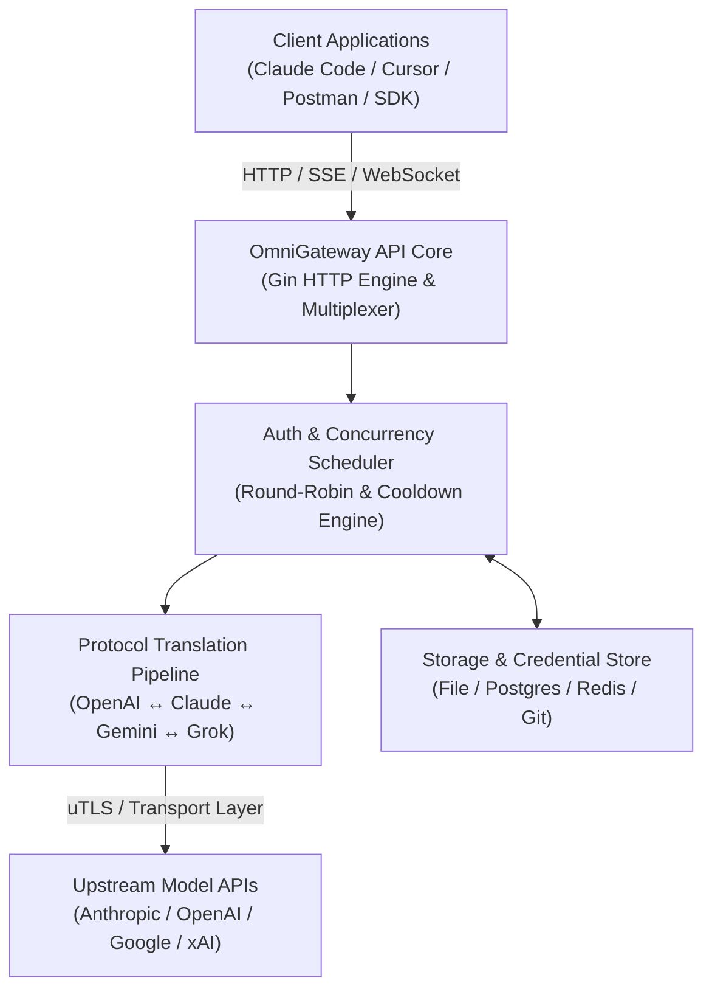

# OmniGateway API

English | [中文](README_CN.md) | [日本語](README_JA.md) | [Project Report](PROJECT_REPORT.md)

---

### 🎓 Academic & Major Project Notice
> **Project Title**: OmniGateway API — Multi-Provider AI Proxy Gateway & Protocol Translator  
> **Course / Track**: B.Tech / B.S. Computer Science & Engineering (3rd Year Major Project)  
> **Developer & Maintainer**: **Yash Raj Sharan** (`yashraj10messi@gmail.com`)  
> **Documentation**: Detailed system analysis and capstone report available in [`PROJECT_REPORT.md`](PROJECT_REPORT.md).

---

## 🏛️ System Architecture

OmniGateway API bridges heterogenous AI service providers (OpenAI, Anthropic Claude, Google Gemini, xAI Grok) into a single, standardized, high-performance gateway.

OmniGateway API is a unified proxy server that provides OpenAI/Gemini/Claude/Codex/Grok compatible API interfaces for CLI models.

You can access the following providers locally and with multiple CLI accounts through any OpenAI (including Responses), Gemini (including Interactions), or Claude-compatible client or SDK.

<table>
<tbody>
    <tr>
        <th align="center" width="100">Provider</th>
        <th align="center">Description</th>
    </tr>
    <tr>
        <td align="center"></td>
        <td>Kimi series models (Kimi K3, Kimi K2.7 Code, etc.). <a href="https://platform.kimi.ai/docs/guide/kimi-k3-quickstart">Kimi K3</a> is Moonshot AI’s most capable model and the world’s first open 3T-class model. With 2.8 trillion parameters, native vision, and a 1-million-token context window, K3 is built for long-horizon coding, knowledge work, and reasoning. OmniGateway API supports Kimi through OAuth or compatible API interfaces. Try the <a href="https://www.kimi.com/code/?aff=cliproxyapi">Kimi Code subscription</a>, or get an API key from the <a href="https://platform.kimi.ai?track_id=track-8a28e4b291d84f62af2fccc3e7a21cb3&aff=cliproxyapi">Kimi Open Platform</a>. Thanks to Kimi for supporting OmniGateway API and the open-source community!</td>
    </tr>
    <tr>
        <td align="center"></td>
        <td>OpenAI GPT series models (GPT 5.6, GPT 5.5, etc.). GPT-5.6 sets a new quality and efficiency baseline for complex production workflows. GPT-5.6 is especially token-efficient and improves frontend aesthetics, including layout, visual hierarchy, and design judgment.</td>
    </tr>
    <tr>
        <td align="center"></td>
        <td>Anthropic Claude series models (Claude Fable, Claude Opus, Claude Sonnet, etc.). Claude Fable 5 is Anthropic's most capable widely released model, built for the most demanding reasoning and long-horizon agentic work.</td>
    </tr>
    <tr>
        <td align="center"></td>
        <td>Google Gemini series models (Gemini 3.5 Flash, Gemini 3.1 Pro, etc.). Gemini 3.5 Flash provides sustained frontier-level intelligence optimized for real-world tasks at a higher speed and lower cost. Designed for the agentic era, it excels at sub-agent deployment, multi-step workflows, and long-horizon tasks at scale. This model is particularly effective for rapid agentic loops involving complex coding cycles and iterations.</td>
    </tr>
    <tr>
        <td align="center"></td>
        <td>xAI Grok series models (Grok 4.5, Grok Composer 2.5 Fast, etc.). Grok 4.5 is SpaceXAI's frontier model built for coding, agentic tasks, and knowledge work. It was trained in SpaceXAI's data centers in Memphis with new datasets spanning science, engineering, and math.</td>
    </tr>
</tbody>
</table>

## Overview

- OpenAI/Gemini/Claude/Grok compatible API endpoints for CLI models
- OpenAI Codex support (GPT models) via OAuth login
- Claude Code support via OAuth login
- Grok Build support via OAuth login
- Streaming, non-streaming, and WebSocket responses where supported
- Function calling/tools support
- Multimodal input support (text and images)
- Multiple accounts with round-robin load balancing (Gemini, OpenAI, Claude, Grok)
- Simple CLI authentication flows (Gemini, OpenAI, Claude, Grok)
- Generative Language API Key support
- AI Studio Build multi-account load balancing
- Claude Code multi-account load balancing
- OpenAI Codex multi-account load balancing
- Grok Build multi-account load balancing
- OpenAI-compatible upstream providers via config (e.g., OpenRouter)
- Reusable Go SDK for embedding the proxy (see `docs/sdk-usage.md`)

## Getting Started

OmniGateway API Guides: [https://help.router-for.me/](https://help.router-for.me/)

## Management API

see [MANAGEMENT_API.md](https://help.router-for.me/management/api)

## Usage Statistics

Since v6.10.0, OmniGateway API and [CPAMC](https://github.com/router-for-me/Cli-Proxy-API-Management-Center) no longer ship built-in usage statistics. If you need usage statistics, use:

### [CPA Usage Keeper](https://github.com/Willxup/cpa-usage-keeper)

Standalone persistence and visualization service for OmniGateway API, with periodic data sync, SQLite storage, aggregate APIs, and a built-in dashboard for usage and statistics.

### [CPA-Manager-Plus](https://github.com/seakee/CPA-Manager-Plus)

Full OmniGateway API management center with request-level monitoring and cost estimates. CPA-Manager tracks collected requests by account, model, channel, latency, status, and token usage; estimates cost with editable model prices and one-click LiteLLM price sync; persists events in SQLite; and provides Codex account-pool operations with batch inspection, quota detection, unhealthy account discovery, cleanup suggestions, and one-click execution for day-to-day multi-account maintenance.

## SDK Docs

- Usage: [docs/sdk-usage.md](docs/sdk-usage.md)
- Advanced (executors & translators): [docs/sdk-advanced.md](docs/sdk-advanced.md)
- Access: [docs/sdk-access.md](docs/sdk-access.md)
- Watcher: [docs/sdk-watcher.md](docs/sdk-watcher.md)
- Custom Provider Example: `examples/custom-provider`

## Contributing

Contributions are welcome! Please feel free to submit a Pull Request.

1. Fork the repository
2. Create your feature branch (`git checkout -b feature/amazing-feature`)
3. Commit your changes (`git commit -m 'Add some amazing feature'`)
4. Push to the branch (`git push origin feature/amazing-feature`)
5. Open a Pull Request

## Author & License

Developed and maintained by **Yash Raj Sharan** (<yashraj10messi@gmail.com>).

This project is licensed under the MIT License - see the [LICENSE](LICENSE) file for details.
